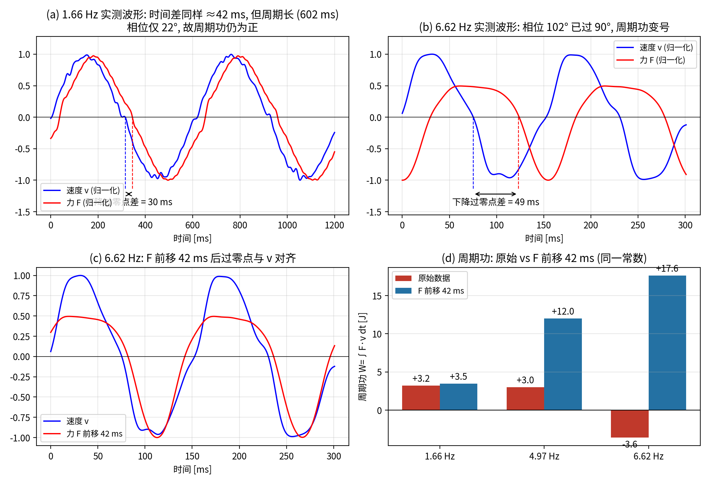
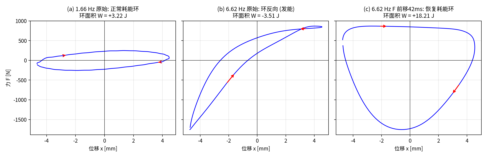

# 2026-10-22 M208 采集通道 42 ms 时延调查

## 背景

- v17（NLCSNN）正模型替换 CarSim 减振器做闭环时发散。
- Codex 测得 v17 模型在稳态正弦位移下**非无源**（周期净发能）：0.5 mm / 0 A / 30 °C 时 2 Hz 吸收 +0.14 J、8 Hz 发能 −0.14 J、12 Hz 发能 −0.98 J；负功主要来自模型输出的 b 分支（5 mm / 8 Hz 时正向阻尼项 +35.15 J，b 项 −154.69 J）。
- 本调查目标：定位发散根源在模型还是数据。物理前提：MR 减振器为半主动器件，完整周期净功必须耗能（按 W = ∫F·v dt 的本文符号约定为正），任何真实时滞/滞回都不能使周期功变号。

## 调查过程与证据

### 1. 训练数据周期功统计：负功只出现在 6.62 Hz

Parsed_Card_force_wide / 1_Steady_Harmonic，57 个可算文件，W = ∫F·v dt（跳过前 2 周期后逐周期平均）：

- 1.66 Hz：0/25 负功
- 4.97 Hz：0/16 负功
- 6.62 Hz：**16/16 全部负功**（5 mm 与 10 mm、0–1.6 A 全部电流均负，与电流、幅值无关）

6.62 Hz 工况最大速度实测 5 mm 幅值 201 mm/s、10 mm 幅值 401 mm/s，与名义 2πfA 吻合，运动本身没问题。

### 2. 基波相位：时延恒定 42 ms（纯时延指纹）

解析后 64 个 SH 文件，F 相对 v 的基波相位差与等效时延：

| 频率 | F−v 相位差 | 等效时延 |
|---|---|---|
| 1.66 Hz | −24.8° | 41.4 ms |
| 4.97 Hz | −76.5° | 42.8 ms |
| 6.62 Hz | −102.5° | 43.0 ms |

全量 42.2 ± 2.7 ms，与频率、幅值、电流无关。相位差严格正比于频率 = 纯时间延迟的特征。周期功变号频率 1/(4τ) ≈ 5.93 Hz，与只有 6.62 Hz 变负吻合；低频数据同样被污染（配对错位 42 ms），只是相位没转过 90°。

### 3. 证明图

数据源：SH_5mm_{1.66, 4.97, 6.62}Hz_0.6A 实测文件。

- (a) 1.66 Hz：F 与 v 的**时间**差同样 ≈42 ms（过零点差 30 ms 为平顶波读数，基波相位 36 ms），只是周期长（602 ms）、相位仅约 22–25°，周期功仍为正；
- (b) 6.62 Hz：F 整体拖在 v 后面，下降过零点差 49 ms（基波相位等效 43 ms），相位 102.5° 已过 90°；
- (c) F 整体前移 42 ms 后，过零点与 v 对齐；
- (d) **只用一个常数 42 ms（不分频率调整）**，三个频率同时修复：周期功 1.66 Hz +3.2→+3.5 J、4.97 Hz +3.0→+12.0 J（被压低的功恢复）、6.62 Hz **−3.6→+17.6 J**。

- (a) 1.66 Hz 原始：正常耗能环，环面积 +3.22 J；
- (b) 6.62 Hz 原始：环变形、方向反转，力峰值 −1750 N 对齐在位移极值处，环面积 −3.51 J；
- (c) 6.62 Hz 仅将 F 前移 42 ms：恢复饱满耗能环，+18.21 J。

减振器本体的性质不可能被"平移时间戳"修好；能被一个固定时间平移同时修好三个频率的，只有通道时间戳错位。

### 4. 独立复验

- 三角波文件（解析后 5_ST 恒流段）F–v 互相关峰值 42 ms，相关 0.973，与相位法一致；
- 记录的 v 与 x（rod_length）数值导数零移位相关 0.9999 → {x, v} 内部对齐，错位在 F 与 {x, v} 两组之间。

### 5. 排除项

- **拉线位移传感器线振动**：位移/速度波形干净（速度峰值与名义 2πfA 仅差 2–4%），且机械振动产生不了全工况恒定的纯时延；
- **力传感器元件**：应变/压电式力传感器响应为 µs–亚 ms 级，做不出 42 ms；
- **模拟低通滤波**：若为时间常数 42 ms 的一阶低通，其基波等效时延应随频率从 39.6 ms 掉到 25.3 ms（6.62 Hz），且力幅值在 6.62 Hz 只剩 50%；实测时延平坦（41.4/42.8/43.0 ms）且对齐后 6.62 Hz 力幅值无衰减 → 排除。恒定时延 + 无幅值衰减是数字环节样本错位的指纹。

### 6. 原始文件全量验证：错位在采集导出时已存在

Raw_Card_Categorized_All（M208 上位机导出的原始 CSV，未解析），五类工况共 234 个可算文件，F 相对运动滞后中位数：

| 工况 | n | 方法 | 滞后 | 相关 |
|---|---|---|---|---|
| 1_SH 正弦（1.66/4.97/6.62 Hz） | 86 | 基波相位 | +39 ~ +42 ms | — |
| 2_SR 随机位移 | 18 | 互相关 | +36 ms | 0.93 |
| 3_RHF 随机高频电流 | 9 | 互相关 | +42 ms | 0.97 |
| 4_RLF 随机低频电流 | 37 | 互相关 | +41 ms | 0.95 |
| 5_ST 阶跃电流三角波 | 33 | 互相关 | +43 ms | 0.94 |

注：1_SH 的 0.41/0.83 Hz 读数偏大（+65/+50 ms），系低频文件周期数少、相位→ms 换算放大估计误差，不作"时延更大"解读。

解析脚本 process_raw_card_archive.py 只做整行裁剪与零相位（filtfilt）滤波，机制上不可能引入通道间时延 → **解析环节排除，错位源头在采集环节**。

### 7. 通道分组定案：力与电流同步，错位在 {力, 电流} 与 {位移} 之间

5_ST 原始文件事件触发平均：筛选运动中的电流阶跃（|v| > 50 mm/s 且阶跃前后不变号）共 **116 个事件**，记录内 F 对 I 阶跃的 50% 响应时延中位数仅 **7 ms**（IQR 4–12 ms），约 25 ms 内响应完成，与减振器真实电流响应量级一致（若 F 比 I 多滞后 42 ms，该值应约 49 ms）。

→ **CH3（力）与 CH4（电流）互相对齐、同一时间基准；42 ms 错位在 {力, 电流} 组与 {位移 CH1} 组之间**，即力/电流两路比位移一路多约 42 ms 延迟（相对量；绝对以哪侧为准，需外部时间基准判定）。温度为缓变量，不参与本问题。

失败记录（作废）：RHF/RLF 互相关测 I→F 两次失败——低速下力-电流耦合被屈服前滞回主导、相关 < 0.31，提不出时延；ST 阶跃多发生在运动停顿段（阶跃前后约 0.4 s v≈0），直接量 I→F 会得到 300–400 ms 的运动重启假象，须先筛运动中事件。

### 8. MTS 真值对比

MTS_Reference / zlbMR_{13, 26, 52, 104}ms_26C.xlsx（MTS ShockNT 导出，传感器为准；列映射：时间 s、位移 mm、速度 mm/s、力 kN）。每文件一个频率、幅值 15 mm、2 个周期、6 个电流 sheet（0–1.5 A）：

| 频率 | 周期功（0→1.5 A） | F 滞后 v |
|---|---|---|
| 1.379 Hz | +9.1 → +74.6 J，全正 | 5–12 ms（相位 3–6°） |
| 2.759 Hz | +11.2 → +81.6 J，全正 | 4–7 ms |
| 5.517 Hz | +17.2 → +86.5 J，全正 | 0.6–4.1 ms |
| 11.035 Hz | +41.4 → +104.8 J，全正 | −0.6 ~ +1.5 ms |

24 个工况周期功全正；F–v 滞后只有几 ms，相位约 2–8°，ms 随频率升高而减小（滞回型相位，非纯时延）。其中 52 ms 文件与 Codex 先前独立计算互验一致（0 A +17.2 J、0.6 A +52.2 J、1.5 A +86.5 J）。

## 结论

1. **v17 闭环发散根源在数据**：训练数据中力（及电流）通道相对位移通道错位约 42 ms，模型学到"力滞后运动 42 ms"；在 12 Hz 相当于约 180° 相位反转，导致高频非无源、闭环泵能发散。模型本身忠实于数据。
2. **减振器真实 F–v 滞后只有几 ms**（MTS 真值，相位 2–8°、随频率减小）；42 ms 恒定纯时延是 **M208 采集链的 artifact**，定案。
3. **错位位置**：M208 采集环节（原始导出即有），{CH3 力、CH4 电流} 同步，与 {CH1 位移} 差约 42 ms。具体机制（卡内按输入类型的滤波/抗干扰处理、上位机拼块缓冲等）未能钉死——M208 说明书载明其带"新的滤波算法"与抗干扰模式、精度按抗干扰模式分档，CH1（mA 型）与 CH3（V 型）/CH4（A 型）调理路径不同，为当前最具体嫌疑。钉死需台架共信号测试（同一阶跃信号同时喂 CH1/CH3/CH4 读回各路偏移 + 通道互换测试）；用户暂无法补实验，存档待办。
4. **修复方案**：全量训练数据将力/电流通道前移 42 ms（1 kHz 下 42 个采样点，以解析后全量统计 42.2 ± 2.7 ms 为准）对齐位移后重训（v19）。验收标准：对齐后 6.62 Hz 周期功转正；残余 F–v 相位呈 MTS 模式（数度、随频率减小）；闭环不再发散。

## 补充（2026-10-22 晚）：力–电流通道间残余不对齐的定量分解

第 7 节测得 F 对 I 阶跃的总响应时延（t50 中位数 7 ms），其中包含执行器真实动态与 CH3/CH4 通道不对齐两个成分，现分解如下。

方法：ST 原始文件事件触发平均（事件筛选同第 7 节，另加速度反向点余量约束；快速全幅阶跃 ΔI 1.0–1.7 A，n=10；平台差扫描与斜率检测两套定位交叉验证）。以实测记录电流的平均波形 ū(t) 为输入（电气斜坡已包含在 ū 内），拟合 F 归一化响应 ŷ =(纯延时 d + 一阶滞后 τ) 作用于 ū。

结果：

- **d = 7.0 ms，τ = 11 ms**，拟合 RMSE 0.039；强制 d=0（τ=19 ms）RMSE 0.136、强制 τ=0（d=15.5 ms）RMSE 0.173，均明显更差 → 纯延时与滞后两个成分都真实存在。
- 稳健性：下阶跃子集（n=8）独立拟合 d=7.5 ms、τ=12 ms；慢过渡事件集拟合 d=5.75 ms；事件重采样 bootstrap：d 中位数 7.0 ms，90% CI [5, 10] ms。
- 总效应的表观值随输入形状变：快速阶跃 t50 ≈ 12–14 ms、慢过渡 ≈ 7–8 ms，约 25 ms 内完成；纯延时 d 不随输入形状变。

归属：

- τ ≈ 11 ms 是**执行器时延**——记录电流变化之后 MR 流体屈服应力的建立/消散动态（线圈电气过程已含在记录电流内，不在此列）。
- d ≈ 6–7 ms 是**纯延时**：流体响应是滞后而非死时间，纯延时只能来自测量链，即 M208 端 CH3（力）相对 CH4（电流）的不对齐（含力变送/调理环节群延时，与卡内处理不可分）。量级为 42 ms 的 1/6，不是同一类问题。
- 通道相对延时（以位移为 0 基准）：**位移 0、电流 ≈ +35 ms、力 ≈ +42 ms**。第 7 节"{力, 电流} 同一时间基准"修正为"相差约 7 ms"；结论第 4 条修复方案细化为分别平移：**F 相对位移 −42 ms、I 相对位移 −35 ms**（等价于 {F, I} 一起 −35 ms、F 再额外 −7 ms）。若 F、I 一起移 −42 ms，训练配对中将残留 F 相对 I 的 7 ms 假死时间（6.62 Hz 约 17°、12 Hz 约 30°相位）。

## 数据与文件索引

- 原始数据：本仓库 `Raw_Card_Categorized_All/`（M208 导出，301 个文件）；MTS 真值：`MTS_Reference/`（commit ec14e14）。
- 采集卡：M208 八通道高速采集卡（24 位 AD、通道隔离、采样 1 ms；用户提供说明书 M208.docx / m.docx）。原始文件头格式 `M-M20X\NORMAL`，GBK 编码，CH1–CH8 并列。
- 通道映射（解析脚本 process_raw_card_archive.py）：CH1 位移（4–20 mA，解析取负 rod_length = 250 − (d − ref)）、CH3 力（0–10 V → N）、CH4 电流、CH6 温度。
- 证明图数据源：Parsed_Card_force_wide / SH_5mm_{1.66, 4.97, 6.62}Hz_0.6A。
