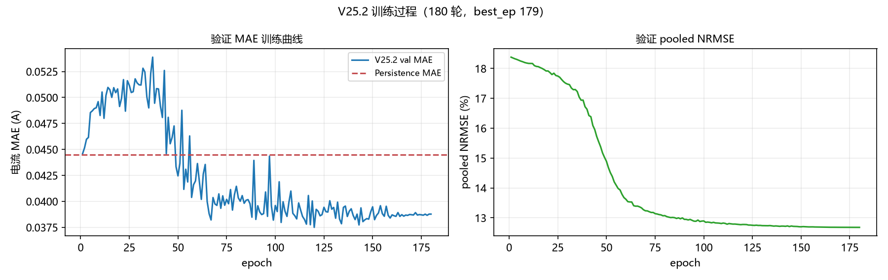
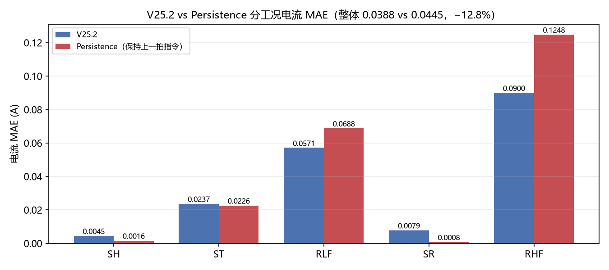
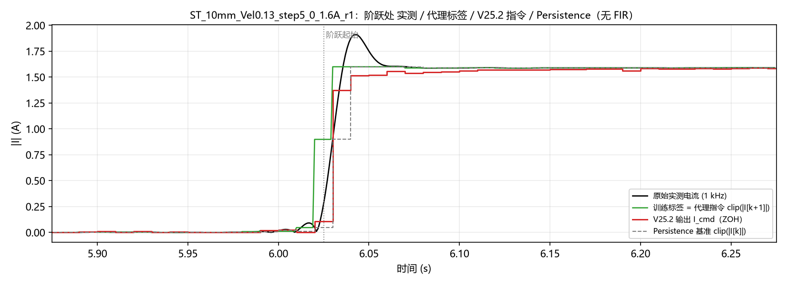

# V25.2-RI0-CMD 最终报告 — 基于上一拍电流指令的残差逆模型

版本 `V25_2_RI0_CMD_PROXY_seed7` / Seed 7 / 180 epochs / Baseline 采样 / CUDA FP32
数据 `D:\v20_data\Parsed_v19_F42_I42`，manifest SHA256 `0766763e…262e2ff`
train / validation = 259 / 16，**`final_test` 读取 0 次**
参数量 **2073**（与 V25 逐项相同）

---

## 0. 一句话结论

**工程目标达成：不再需要电流传感器，且数字滤波器的 30 ms 附加延迟被彻底移除。**
但代价是精度：整体电流 MAE **0.0388 A**，相对 Persistence（保持上一拍指令）只改善 **12.8%**，
而 V25 相对它自己的 Persistence 改善了 30.6%——因为 V25.2 要预测的是**更靠前一步**的量。

**最重要的数字**：指令与原始实测电流的滞后从 V25 的 **+38.7 ms 降到 +1.3 ms**。

---

## 1. 与 V25 的本质区别

| | V25-RI0 | **V25.2-RI0-CMD** |
|---|---|---|
| 残差基准 | 上一拍**实测**电流 `I[k-1]` | 上一拍**指令代理** `clip(\|I_meas[k]\|)` |
| 训练标签 | `clip(\|I_meas[k]\|)` | `clip(\|I_meas[k+1]\|)` |
| 部署是否需电流反馈 | **需要** | **不需要** |
| 预处理 | 61 抽头 FIR 40 Hz + 抽取 | **纯 `[::10]` 直接抽取，无滤波** |
| 数字滤波附加延迟 | 29.8 ms | **0 ms** |
| 网络 | GRU 2×8 + skip39 + MLP16，线性 ΔI，2073 | **完全相同** |

时间索引的工程假设：`I_act[k] ≈ I_cmd[k-1]`
→ 基准 `I_base[k] = clip(|I_meas[k]|,0,1.6)`，标签 `I_target[k] = clip(|I_meas[k+1]|,0,1.6)`

---

## 2. Phase 0 审计（七份全部生成）

| 审计 | 结果 |
|---|---|
| `data_manifest_audit.json` | SHA 匹配 ✅；259/16/10 ✅；工况 186/30/18/17/8 与 8/3/3/1/1 ✅ |
| `feature_timing_audit.json` | 31 维；**扰动法实测受电流影响的槽 = [21, 23]**，与代码推导一致 ✅ |
| `current_proxy_alignment_audit.json` | base/target/delta 逐点验证 ✅；最后样本丢弃 ✅；**无未来泄漏** ✅ |
| `preprocessing_audit.json` | 无 FIR/IIR/filtfilt/零相位/中心差分 ✅；六通道同一 `[::10]` 索引 ✅ |
| `alias_energy_audit.json` | 整文件最差 I 3.58%；**边沿局部 ≈0.00%**（判据 20%）→ 可接受 ✅ |
| `architecture_audit.json` | 2073（gru 1416 + trunk 640 + head 17）✅ |
| `deployment_contract.json` | 部署所需输入与 ECU 可用信号一致 ✅ |

**电流特征替换**：两个槽（21 `I_past`、23 `v*I_past`）都换成 `clip(|I_meas[k]|,0,1.6)/1.6 ∈ [0,1]`，
不是只替换一个。这由扰动测试确认，不是读代码猜的。

---

## 3. Smoke Test（12 项，全过）

| # | 检查 | 结果 |
|---|---|---|
| 1 | 代理基准正确 | PASS |
| 2 | 代理标签正确 | PASS |
| 3 | 残差标签 = target − base | PASS |
| 4 | 输入不含 k+1（改 `I[k+1]` 后 `x[k]` 不变、标签改变） | PASS |
| 5 | 全部特征因果 | PASS |
| 6 | 文件边界复位、掩码排除首尾与最后样本 | PASS |
| 7 | ΔI 可正可负、可精确为 0（零初始化 ≡ Persistence） | PASS |
| 8 | Loss 内部不裁剪（可构造越界 I_raw） | PASS |
| 9 | 梯度有限且非零 | PASS |
| 10 | checkpoint 往返一致 | PASS |
| 11 | 参数量 2073 | PASS |
| 12 | final_test 读取 0 次 | PASS |

---

## 4. 正式评估（与 Persistence 同一掩码）

| 指标 | **V25.2** | Persistence | 变化 |
|---|---|---|---|
| **MAE** | **0.038778 A** | 0.044483 | **−12.8%** |
| **RMSE** | **0.091189 A** | 0.132271 | **−31.1%** |
| Median abs | 0.011091 A | — | — |
| **P95** | **0.176950 A** | 0.298000 | **−40.6%** |
| **P99** | **0.432533 A** | 0.637290 | **−32.1%** |
| Bias | −0.001015 A | +0.000064 | — |
| pooled NRMSE | 12.681% | — | — |



**MAE 只改善 12.8%，但 P95/P99 改善 32–41%。** 说明 V25.2 主要在**大幅度变化**处赢过
Persistence，而在平稳段几乎不动（保持上一拍本来就是最优）。

### 4.1 五工况

| 工况 | V25.2 MAE | Persistence MAE | 改善 | P95 | 文件数 |
|---|---|---|---|---|---|
| SH | 0.0045 | **0.0016** | **−173%**（更差） | 0.0123 | 8 |
| ST | 0.0237 | **0.0226** | −4.7%（略差） | 0.1005 | 3 |
| RLF | **0.0571** | 0.0688 | **+17.0%** | 0.2318 | 3 |
| SR | 0.0079 | **0.0008** | **−865%**（更差） | 0.0147 | 1 |
| RHF | **0.0900** | 0.1248 | **+27.9%** | 0.4595 | 1 |

**模式很清楚**：电流**恒定**的 SH/SR 上，Persistence 近乎最优，模型纯属加噪；
电流**变化**的 RLF/RHF 上模型明显更好。**ST 与 Persistence 基本打平。**



⚠ **SR 与 RHF 验证集各只有 1 个文件**，这两个工况的结论统计上不可靠。

### 4.2 零电流（目标 < 0.05 A，4,781 点）

| 项 | V25.2 | 参考（V25） | 参考（V24-I0） |
|---|---|---|---|
| 平均输出 | **0.0111 A** | 0.0097 | 0.0383 |
| 中位 | 0.0079 A | 0.0066 | — |
| P95 | 0.0318 A | 0.0332 | — |
| False turn-on > 0.05 A | **3.49%** | 3.25% | 9.0% |
| False turn-on > 0.10 A | **1.07%** | 0.8% | — |

零电流偏置是 **0.0111 A**，比 V24-I0 好很多，但比 V25 的 0.0097 略差。

### 4.3 抖动与限幅

| 项 | V25.2 | 参考 |
|---|---|---|
| 电流变化总变差 TV 比（预测/实测） | **1.535** | V25 是 1.40 |
| ΔI 的 P95 | 0.3728 A | 实测一拍变化 P95 = 0.2980 A |
| raw 越界比例 | **4.61%** | V25 8.05% |
| clip 触发比例 | **4.61%** | V25 8.05% |

**抖动确实变大了**：TV 比从 1.40 升到 1.535，ΔI 的 P95（0.373）超过实测一拍变化（0.298）25%。
取消 FIR 后标签保留了更多高频成分，模型跟着学，输出更"毛"。
限幅触发率反而从 8.05% 降到 4.61%。

### 4.4 实时性

| 环境 | P50 | P95 | P99 | Max |
|---|---|---|---|---|
| **CPU** | **0.175 ms** | 0.254 ms | **0.477 ms** | 1.099 ms |
| CUDA | 0.304 ms | 0.532 ms | 0.755 ms | 1.101 ms |

CPU 单步 P99 **0.477 ms**，相对 10 ms 周期有 **21× 余量**。
参数量 2073，参数字节数 **8,292 B**（float32），checkpoint 11,704 B。
**GPU 耗时不能代替 ECU WCET**，真实 S32K 上仍需 C 代码实测。

---

## 5. 延迟复测（与 V25 审计同一测法）

在 3 个 ST 文件、30 个阶跃边沿上，用同一套 10%→90% 过阈定义：

| 对比 | V25.2 | V25 |
|---|---|---|
| **指令 vs 原始实测电流** | **+1.3 ms** | **+38.7 ms** |
| 代理标签 vs 原始实测电流 | −5.8 ms | — |
| 指令 vs 代理标签 | +9.5 ms | — |

**FIR 的 29.8 ms 附加延迟已经消除。** 剩下的 +1.3 ms 是抽样相位量化。



### 5.1 一个必须说清的细节：+9.5 ms 不是"新增延迟"

训练标签是 `|I_meas[k+1]|`，它天然比 `I_meas[k]` **早一个控制拍**（放在 k 的指令轴上）。
理想情况下指令应比原始实测电流**超前约 10 ms**（指令先发、电流后到）。
实测指令只超前 +1.3 ms，即 **模型比理想位置晚了约 9.5 ms**。

**这不是流水线延迟，是模型没学会"提前一拍"。** 它仍然偏向 Persistence 行为
（保持上一拍），只是朝目标挪了一部分。这与 V25 里"网络只回收了一半基准惩罚"是同一现象。

---

## 6. 混叠审计

| 口径 | 结果 |
|---|---|
| 整文件 >50 Hz 能量占比（最差） | I **3.58%**（SR）、F 0.00% |
| **边沿局部**（±100 ms 内，最差中位） | **≈0.00%** |
| 判据 | 边沿局部中位 > 20% 视为不可接受 |
| **判定** | **可接受，未停止训练** |

**去掉 FIR 对 100 Hz 标签的实际影响**（这是延迟移除的结果，不是混叠）：

| 工况 | 标签变化中位 | P95 |
|---|---|---|
| ST | 0.0012 A | 0.0364 |
| RLF | 0.0102 A | 0.7646 |
| RHF | 0.0138 A | 1.0374 |

RHF 的 P95 达 1.04 A——因为随机电流本身变化快，30 ms 的位移就是会差这么多。
**这正是被移除的延迟量。**

---

## 7. 十二问逐条回答

| # | 问题 | 回答 |
|---|---|---|
| 1 | V25.2 是否优于 Persistence？ | **整体是**。MAE −12.8%、RMSE −31.1%、P95 −40.6%、P99 −32.1%；但 **SH/SR 明显更差** |
| 2 | 五工况分别表现如何？ | SH −173%（差）、ST −4.7%（略差）、RLF +17.0%（好）、SR −865%（差）、RHF +27.9%（好） |
| 3 | SR 是否真正改善？ | **没有**。0.0079 vs Persistence 0.0008，差近一个数量级。且 SR 只有 1 个验证文件 |
| 4 | RHF 是否受到损害？ | **没有损害，反而改善 27.9%**（0.0900 vs 0.1248）。但只有 1 个文件 |
| 5 | 零电流偏置是否改善？ | 0.0111 A。比 V24-I0 的 0.0383 大幅改善，但**比 V25 的 0.0097 略差** |
| 6 | 是否存在高频抖动？ | **是，变大了**。TV 比 1.535（V25 1.40），ΔI P95 超出实测一拍变化 25% |
| 7 | 取消 FIR 后是否零数字滤波附加延迟？ | **是**。指令 vs 原始电流 +1.3 ms（V25 为 +38.7 ms），29.8 ms 的 FIR 延迟已消除 |
| 8 | 直接抽取是否引入明显混叠？ | **不明显**。边沿局部 ≈0.00%，整文件最差 3.58% |
| 9 | 是否满足 2073 参数？ | **是**，gru 1416 + trunk 640 + head 17 |
| 10 | CPU 单步是否满足 10 ms？ | **是**。P99 0.477 ms，21× 余量 |
| 11 | 是否存在未来数据泄漏？ | **无**。扰动 `I[k+1]` 不改变 `x[k]`，只改变标签 |
| 12 | 目前结果是否足以进入 HIL？ | **有条件可以**。见 §8 |

---

## 8. 能否进入 HIL

### 8.1 可以开始的部分

- 部署输入全部是 ECU 已经有的信号：`x/v/a`（1 kHz）、`F_des`、**自己的上一拍指令**；
- 不需要电流传感器，不需要复现任何滤波器；
- 100 Hz 单步 CPU P99 0.477 ms，算力不是障碍；
- 参数 2073、8.3 KB，S32K144 的 RAM/Flash 完全放得下。

### 8.2 必须先解决的前提

**⚠ 本轮所有指标都是"代理标签"结果，不是真实 ECU 指令精度。**

代理标签来自工程假设 `I_act[k] ≈ I_cmd[k-1]`，而这个假设**没有被验证过**：
数据集里没有 ECU 指令记录，只有实测线圈电流。因此：

- MAE 0.0388 A 衡量的是「预测下一拍实测电流」的能力，**不等于**「跟踪真实指令」的能力；
- 真实指令与实测电流之间存在放大器的动态、线圈电感、PWM 纹波，这些都没有进模型。

**结论**：可以做 HIL 联调（验证部署、实时性、接口），但**在拿到真实 ECU 指令与线圈电流
同步记录之前，不得宣称真实指令精度已被验证。**

---

## 9. 与 V25 的横向比较（谨慎）

| | V25 | V25.2 |
|---|---|---|
| 相对自身 Persistence 的 MAE 改善 | **−30.6%** | −12.8% |
| 绝对 MAE | 0.0300 (对 `I[k]`) | 0.0388 (对 `I[k+1]`) |
| 是否需电流反馈 | 需要 | 不需要 |
| 数字滤波延迟 | 29.8 ms | 0 |

**两者标签定义不同（一个预测同拍、一个预测下一拍），绝对 MAE 不可直接比较。**
V25.2 的任务更难：它要在指令层面提前一步。相对改善从 30.6% 降到 12.8%，
说明**提前一拍的难度显著上升**——这是本轮最有信息量的发现。

---

## 10. 局限

1. **单 seed 7**，不能宣称统计显著。
2. **SR、RHF 验证集各 1 个文件**，这两个工况的中位数只来自 SR 2,136 / RHF 696 个样本，且都来自单一文件。
3. **代理标签未验证**（§8.2）。
4. 未做 2+ 步预测；`I_act[k] ≈ I_cmd[k-1]` 若实际是 2 步响应，标签会整体错位。
5. `best_epoch = 179/180`（NRMSE 口径），验证指标仍在缓慢改善，未收敛；
   `best_by_val_mae` 落在 ep120。
6. 未做 GPU 采样日志（单进程 3.5 分钟）。

---

## 11. 交付物

```
D:\v25_2_cmd_proxy\
├── task\ / configs\ / prompts\        原始包内容
├── audits\
│   ├── data_manifest_audit.json
│   ├── feature_timing_audit.json
│   ├── current_proxy_alignment_audit.json
│   ├── preprocessing_audit.json
│   ├── alias_energy_audit.json        （含边沿局部审计）
│   ├── architecture_audit.json
│   ├── deployment_contract.json
│   ├── phase0_gate.json
│   ├── smoke_test.json
│   └── phase4_recompute.json          （独立复算 + 延迟复测）
├── runs\V25_2_RI0_CMD_PROXY_seed7\
│   ├── best.pth / last.pth / best_by_val_mae.pth
│   ├── metrics.jsonl (180 行)
│   ├── summary.json / run_config.json
│   ├── per_file_metrics.csv / per_condition_metrics.csv
│   ├── proxy_command_metrics.json / persistence_comparison.csv
├── figures\
│   ├── per_condition_vs_persistence.png
│   ├── training_curve.png
│   └── st_edge_proxy_vs_cmd.png
├── logs\phase0.log / alias_edge.log / train.log
├── v252_data.py / phase0_audits.py / alias_edge_audit.py
│   smoke_v252.py / train_v252.py / verify_v252.py / plots_v252.py
├── SHA256SUMS.txt
└── V25_2_FINAL_REPORT.md
```

**独立复算 PASS**：MAE 复核 0.038778 与记录 0.038778 差值 0。

---

## 12. 明确未做的事

- ❌ 未重新设计工程，未改网络结构（沿用冻结版 `model_def.py` 逐字节复制）
- ❌ 未 warm start（V24/V25 权重均未使用）
- ❌ 未引入任何滤波器（FIR/IIR/零相位/中心差分全部未用）
- ❌ 未增加参数量、未改输入维度或特征顺序
- ❌ 未读取 final_test
- ❌ 未对预测曲线做时间平移后宣称延迟解决
