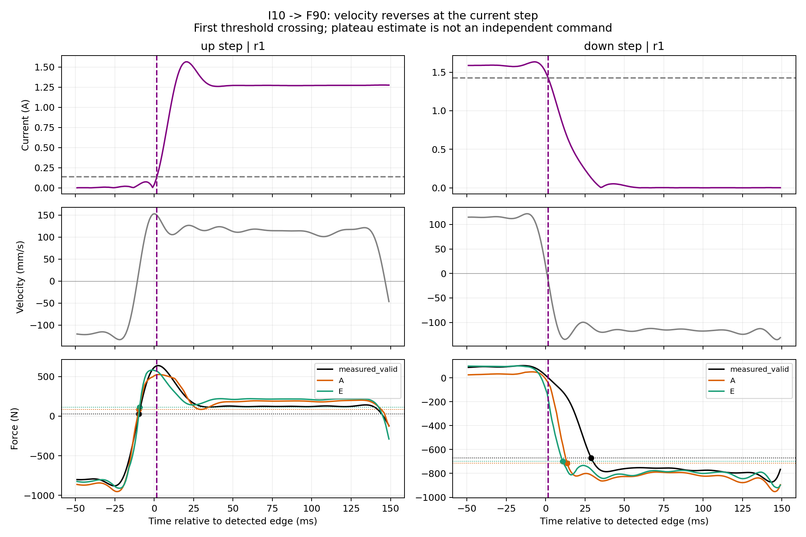

# v20 电流 10% → 力 90% 时延重新统计

## 定义与范围

`delay = t(F0 + 0.9*(F1-F0)) - t(I0 + 0.1*(I1-I0))`。下降阶跃同样按完成变化量计算，即终点阈值为 F0 向 F1 变化的 90%，不是绝对力幅值的 90%。

读取 33 个 ST 文件（30 训练 + 3 验证），没有读取最终测试 CSV。其他 SH/SR/RLF/RHF 不在此次阶跃统计中；没有可靠电流平台和力稳态时，不能直接套用阶跃 10%→90% 定义。

文件不含独立的目标电流命令。使用实测电流幅值的阶跃后平台中位数代理目标值，未把名义 1.6A 强加给各个阶梯。时间轴中 F、I 同时前移 42 点，因此该共同平移不改变二者的相对时延。

主窗口：陡变开始前 [−30,−10) ms 估计 I0/F0；最后陡变点后 [30,80) ms 估计 I1/F1。用首个定向越阈点，线性插值，信号不平滑，不是进入并保持误差带的稳定时间。1kHz 数据不应把插值小数解读成亚毫秒测量精度。

电流差分 >0.04A/点检测陡变，相邻候选间隔≤40ms合并；阶跃幅度至少0.3A、力变化至少30N。候选剔除原因保存在 delay_10_90.json。

## 质量筛选

从全体 320 个可计算实测事件中保留122个：上升55、下降67。排除速度换向（窗口中同时出现 v<−10 与 v>10 mm/s）、前后速度变化超过 max(10mm/s,10%幅值)、低速、平台不平、力早于电流阈值。平台不平判据：半窗中位数漂移 > max(10%阶跃幅度, I:0.02A/F:10N)，或 P90−P10 > max(20%阶跃幅度,I:0.04A/F:20N)。所有事件及标记均保留，没有将负时延截断成0。

筛选是分析用的可审查规则，不等于已证明速度、位置及摩擦影响完全消失。平台值仍是窗口估计，不是另做静态试验得到的真稳态值。

## 总体（筛选后实测事件）

| 方向 | 事件数 | 中位数 ms | 均值 ms | P10–P90 ms |
|---|---:|---:|---:|---:|
| 上升 | 55 | 22.8 | 24.9 | 18.6–31.5 |
| 下降 | 67 | 26.0 | 26.4 | 20.0–33.3 |

## 各工况及 A/E 同事件对照

A/E 均为 v20 seed7 best（A epoch126，E epoch127），使用 checkpoint 自带归一化，以实测历史推理，没有重新训练。此处入选事件都来自训练文件；3个验证文件的匹配阶跃全部发生速度换向，不能作为隔离电流响应的验证证据。不要将此表称为独立测试成绩。

模型各用自身的 F0/F1 算相对响应时间，故并不同时检验稳态幅值误差。按实测质量筛选后逐事件配对；A/E 自身平台不平等标记在 CSV 列中保留。另在 summary.json 提供三条曲线同时通过全部判据的更严格子集。

| 工况 | 方向 | 实测n | 实测中位数 | 配对n | 配对实测 | A | E |
|---|---|---:|---:|---:|---:|---:|---:|
| ST_10mm_Vel0.05 | ↓ | 1 | 18.5 | 1 | 18.5 | 1.6 | 17.7 |
| ST_10mm_Vel0.05 | ↑ | 1 | 27.5 | 1 | 27.5 | 22.1 | 14.1 |
| ST_10mm_Vel0.13 | ↓ | 1 | 22.4 | 1 | 22.4 | 11.0 | 14.7 |
| ST_10mm_Vel0.26 | ↓ | 1 | 27.5 | 1 | 27.5 | 20.6 | 18.2 |
| ST_10mm_Vel0.26 | ↑ | 1 | 38.0 | 1 | 38.0 | 41.2 | 16.1 |
| ST_20mm_Vel0.13_step5_0_1.6A | ↓ | 13 | 24.6 | 12 | 22.8 | 27.8 | 18.2 |
| ST_20mm_Vel0.13_step5_0_1.6A | ↑ | 13 | 22.6 | 13 | 22.6 | 19.8 | 13.8 |
| ST_30mm_Vel0.05 | ↓ | 1 | 21.8 | 1 | 21.8 | 22.7 | 15.8 |
| ST_30mm_Vel0.13 | ↓ | 1 | 21.4 | 1 | 21.4 | 8.4 | 12.8 |
| ST_30mm_Vel0.13 | ↑ | 1 | 23.3 | 1 | 23.3 | 20.0 | 12.6 |
| ST_30mm_Vel0.13_step5_0_1.6A | ↓ | 4 | 25.5 | 4 | 25.5 | 23.9 | 16.3 |
| ST_30mm_Vel0.13_step5_0_1.6A | ↑ | 2 | 34.1 | 2 | 34.1 | 28.1 | 18.5 |
| ST_30mm_Vel0.26 | ↓ | 1 | 30.8 | 1 | 30.8 | 25.4 | 23.3 |
| ST_30mm_Vel0.26 | ↑ | 1 | 29.1 | 1 | 29.1 | 40.3 | 22.5 |
| ST_30mm_Vel0.26_step5_0_1.6A | ↓ | 4 | 29.4 | 4 | 29.4 | 27.6 | 20.6 |
| ST_30mm_Vel0.26_step5_0_1.6A | ↑ | 2 | 29.0 | 2 | 29.0 | 41.0 | 22.8 |
| ST_50mm_Vel0.13 | ↓ | 1 | 28.7 | 1 | 28.7 | 26.2 | 24.6 |
| ST_50mm_Vel0.13 | ↑ | 1 | 34.0 | 1 | 34.0 | 27.3 | 18.9 |
| ST_50mm_Vel0.13_step5_0_1.4A | ↓ | 3 | 24.2 | 3 | 24.2 | 25.1 | 21.3 |
| ST_50mm_Vel0.13_step5_0_1.4A | ↑ | 1 | 36.7 | 1 | 36.7 | 28.2 | 19.2 |
| ST_50mm_Vel0.13_step5_0_1.6A | ↓ | 18 | 24.4 | 18 | 24.4 | 24.2 | 23.3 |
| ST_50mm_Vel0.13_step5_0_1.6A | ↑ | 18 | 22.2 | 18 | 22.2 | 19.5 | 13.2 |
| ST_50mm_Vel0.26 | ↓ | 1 | 26.6 | 1 | 26.6 | 18.7 | 22.5 |
| ST_50mm_Vel0.26 | ↑ | 1 | 23.4 | 1 | 23.4 | 17.6 | 13.2 |
| ST_50mm_Vel0.26_step5_0_1.6A | ↓ | 17 | 28.3 | 17 | 28.3 | 23.0 | 23.1 |
| ST_50mm_Vel0.26_step5_0_1.6A | ↑ | 13 | 22.7 | 13 | 22.7 | 17.8 | 12.9 |

所有时延单位 ms。单事件行不能代表稳定的工况统计。

## 原先三个验证文件的问题

相同有效区间里三曲线可配对45个事件（上升21、下降24），全部有速度换向。实测上/下中位数22.98/26.74ms；A为21.88/27.17ms；E为21.48/25.57ms。这些只能称电流与运动共同作用的表观10%→90%时延。旧脚本“50ms内速度只变约4mm/s”不适用于这些阶跃：在事件处速度由约+120变−120mm/s，或相反。

## 稳态窗口敏感性

后窗口 [20,50)、[30,80)、[50,100) ms，筛选后实测上升中位数分别22.88、22.81、22.46ms；下降25.48、26.02、27.13ms。各窗口合格样本不同，不能当作严格配对敏感性。逐事件数据均已保存。

## 文件

- `clean_condition_comparison.csv`：筛选后的逐工况及 A/E 同事件表。
- `events.csv`：全部主窗口事件、阈值时刻、前后平台和质量标记。
- `delay_10_90.json`：全部事件、窗口敏感性、剔除原因和输入哈希。
- `summary.json`：汇总、严格共同子集和算法检查。
- `predictions/manifest.json`：A/E权重、源码、预测文件哈希；原始训练文件与权重未修改。
- `analyze_delay.py` / `predict_st.py` / `report_delay.py`：复现脚本。

没有将时延设为训练目标，没有修改正模型、采集对齐或旧结果。
