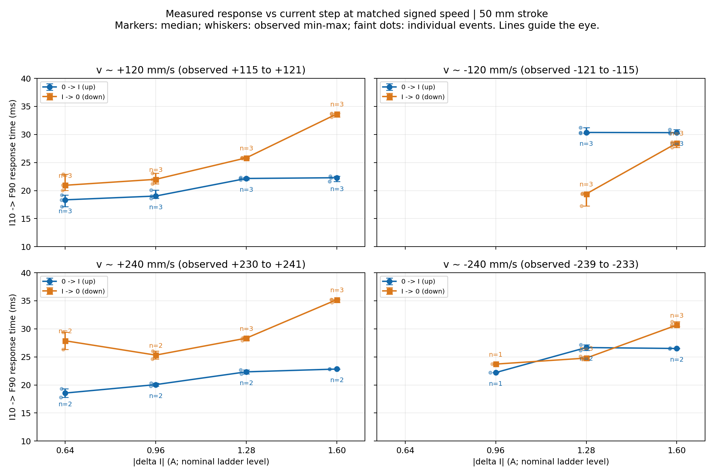
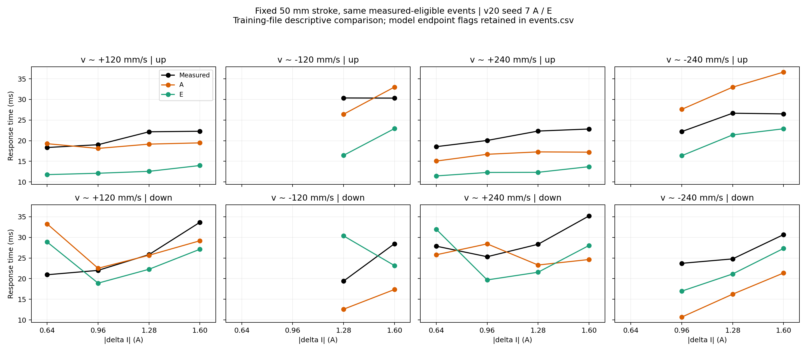

# 固定速度下 ΔI 与 10%→90% 时延的关系

固定50mm行程；按实测有符号速度约 ±120、±240mm/s 分组（对应文件名 Vel0.13/0.26）。正负速度单独处理，未假定正号就是压缩或回弹。保留前次同一套平台/运动质量筛选，无为获得单调趋势重新调整阈值。

上升只比较 I0≈0 → I1；下降只比较 I0 → I1≈0。下降时 ΔI 与初始电流同时改变，不能据此识别“独立于初始电流的 ΔI 效应”。横轴是电流阶梯名义幅值，CSV保留实际幅值。实际幅值约比名义低0.01–0.02A。

| 实测速度组 mm/s | 方向 | ΔI幅值 A | n | 时延中位数 ms | 最小–最大 ms |
|---:|---|---:|---:|---:|---:|
| +120 | up | 0.64 | 3 | 18.35 | 17.13–19.18 |
| +120 | up | 0.96 | 3 | 19.03 | 18.65–20.07 |
| +120 | up | 1.28 | 3 | 22.16 | 21.91–22.30 |
| +120 | up | 1.60 | 3 | 22.29 | 21.62–22.54 |
| +120 | down | 0.64 | 3 | 20.95 | 20.01–22.92 |
| +120 | down | 0.96 | 3 | 22.00 | 21.21–23.12 |
| +120 | down | 1.28 | 3 | 25.83 | 25.73–25.88 |
| +120 | down | 1.60 | 3 | 33.66 | 33.10–33.74 |
| -120 | up | 1.28 | 3 | 30.36 | 30.20–31.25 |
| -120 | up | 1.60 | 3 | 30.33 | 30.14–30.88 |
| -120 | down | 1.28 | 3 | 19.41 | 17.25–19.50 |
| -120 | down | 1.60 | 3 | 28.46 | 27.67–28.63 |
| +240 | up | 0.64 | 2 | 18.55 | 17.81–19.30 |
| +240 | up | 0.96 | 2 | 20.06 | 19.81–20.31 |
| +240 | up | 1.28 | 2 | 22.33 | 21.99–22.67 |
| +240 | up | 1.60 | 2 | 22.83 | 22.81–22.85 |
| +240 | down | 0.64 | 2 | 27.87 | 26.36–29.38 |
| +240 | down | 0.96 | 2 | 25.32 | 24.61–26.02 |
| +240 | down | 1.28 | 3 | 28.34 | 27.95–28.45 |
| +240 | down | 1.60 | 3 | 35.20 | 34.72–35.23 |
| -240 | up | 0.96 | 1 | 22.20 | 22.20–22.20 |
| -240 | up | 1.28 | 2 | 26.66 | 26.17–27.16 |
| -240 | up | 1.60 | 2 | 26.50 | 26.44–26.55 |
| -240 | down | 0.96 | 1 | 23.72 | 23.72–23.72 |
| -240 | down | 1.28 | 3 | 24.79 | 24.55–25.09 |
| -240 | down | 1.60 | 3 | 30.67 | 30.40–31.27 |

## 同文件内的幅值比较

为避免不同幅值恰好使用了不同重复文件，在同一个文件、同一速度方向、同一电流上/下方向内计算相邻可用幅值的时延差。这里只报告计数，不将同文件事件当作独立样本做显著性检验。

- v≈+120 mm/s，up：4个幅值；各档中位数严格递增=True；同文件相邻幅值比较 6/9 次为正增量。
- v≈+120 mm/s，down：4个幅值；各档中位数严格递增=True；同文件相邻幅值比较 9/9 次为正增量。
- v≈-120 mm/s，up：2个幅值；各档中位数严格递增=False；同文件相邻幅值比较 0/3 次为正增量。
- v≈-120 mm/s，down：2个幅值；各档中位数严格递增=True；同文件相邻幅值比较 3/3 次为正增量。
- v≈+240 mm/s，up：4个幅值；各档中位数严格递增=True；同文件相邻幅值比较 6/6 次为正增量。
- v≈+240 mm/s，down：4个幅值；各档中位数严格递增=False；同文件相邻幅值比较 5/7 次为正增量。
- v≈-240 mm/s，up：3个幅值；各档中位数严格递增=False；同文件相邻幅值比较 2/3 次为正增量。
- v≈-240 mm/s，down：3个幅值；各档中位数严格递增=True；同文件相邻幅值比较 4/4 次为正增量。

## 解释边界

速度匹配是近似匹配，并非每点速度严格相同。除控制行程、速度方向及电流方向外，事件的位置、历史和阶梯顺序仍有差异。最多3个重复文件；一些档只有1个事件。0.32A档在固定50mm且通过原质量筛选的事件中没有可用数据，空缺不插补。

结果用于描述本批数据的条件趋势，不能据此声称全局单调规律或唯一的 ΔI→时延函数，也不能将10%→90%响应时间直接当作一阶时间常数。三个验证ST文件受换向混杂，图中使用的是训练文件的实测数据；未读取最终测试。

模型曲线使用之前已保存的 A/E 推理结果，无重新训练；质量标记在 events.csv 中保留。

